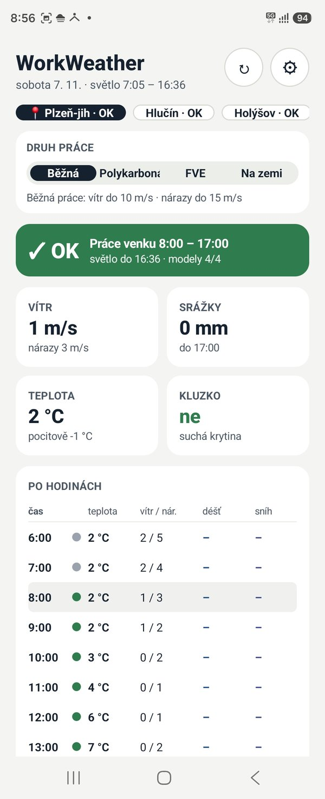
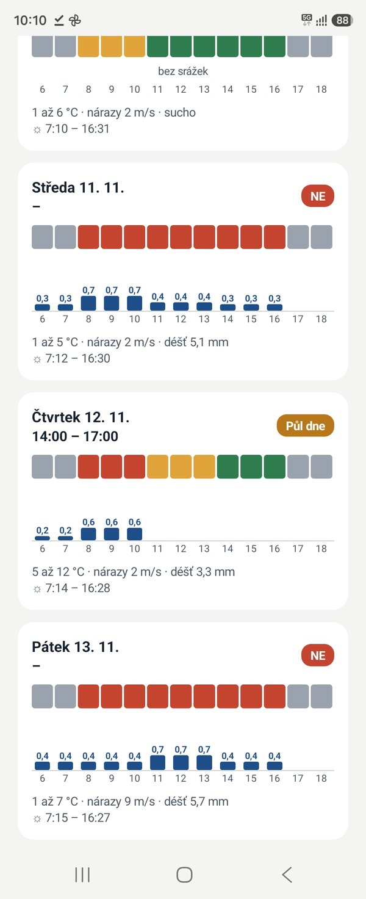
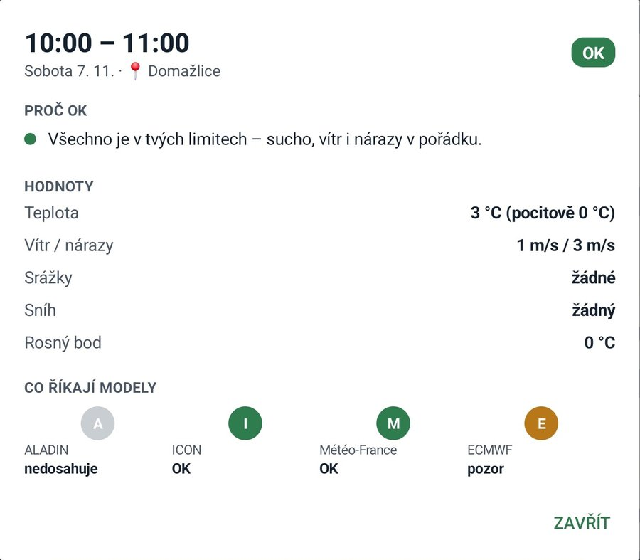
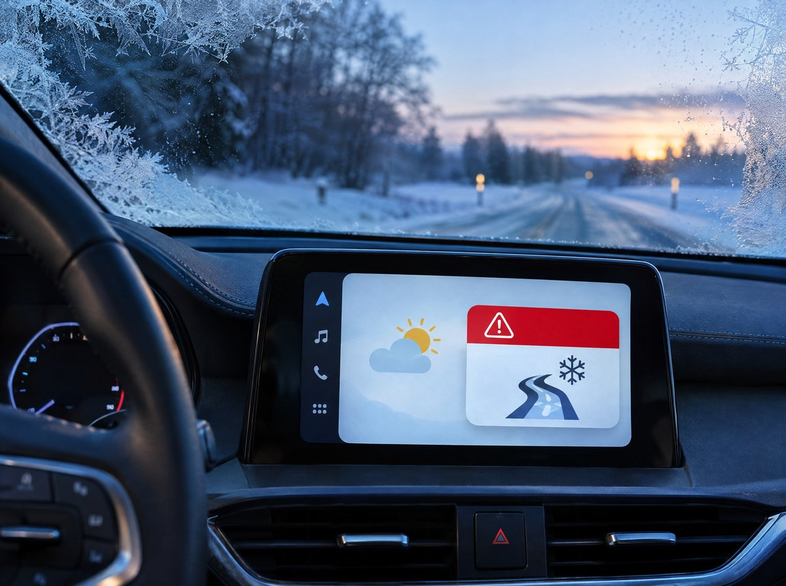

# WorkWeather

**Počasí pro práci venku** – Android aplikace, která jedním pohledem řekne, jestli se dnes dá pracovat na střeše: **OK**, **Půl dne** nebo **NE**, a přesně od kdy do kdy.

## ⬇️ Stažení

**[Stáhnout WorkWeather.apk (nejnovější verze)](https://github.com/tmwaligora-ui/WorkWeather/releases/download/latest/WorkWeather.apk)**

Odkaz vede vždy na nejnovější verzi. · 📄 [Brožura v PDF](WorkWeather-brozura.pdf)

## Ukázky

## Instalace

1. Otevři odkaz výše v telefonu a stáhni soubor `WorkWeather.apk`.
2. Otevři stažený soubor. Telefon se zeptá, jestli povolit instalaci z tohoto zdroje (prohlížeč / Soubory) – povol.
3. Nainstaluj a spusť. Aplikace požádá o polohu (předpověď pro místo, kde jsi) a o oznámení (varování během práce).

Novější verze se nainstaluje přes starou, místa a nastavení zůstanou.

## Co umí

- Verdikt a pracovní okno na dnes, týden i 14 dní
- Aktuální poloha telefonu a další místa (zakázky)
- Druh práce: běžná práce, polykarbonát, FVE panely, práce na zemi – každý s vlastními limity větru
- Shoda čtyř modelů: ALADIN (ČHMÚ), ICON, Météo-France, ECMWF – při neshodě „Nejisté“
- Výstrahy ČHMÚ, varování před deštěm a nárazy během práce
- Grafy srážek a nárazů větru, radar srážek
- Silnice: náledí, sníh a námraza na skle auta – oznámení večer a ráno
- Samsung Galaxy Z Fold: složený rychlý přehled, rozložený dva panely
- Android Auto

## Android Auto

Aplikace není z Obchodu Play, proto ji Android Auto zobrazí jen se zapnutými **neznámými zdroji**:

1. Nastavení → Připojená zařízení → Předvolby připojení → **Android Auto**.
2. Úplně dole 10× klepni na **Verze**, potvrď → zapne se režim pro vývojáře.
3. Vpravo nahoře ⋮ → **Nastavení pro vývojáře** → zaškrtni **Neznámé zdroje**.
4. V Android Auto → **Přizpůsobit spouštěč** zkontroluj, že je WorkWeather zaškrtnutý.
5. Odpoj a znovu připoj telefon k autu.

---

Data: Open-Meteo, výstrahy Meteoalarm, radar Windy. Aplikace pomáhá s rozhodnutím, nenahrazuje posouzení rizik na místě.
